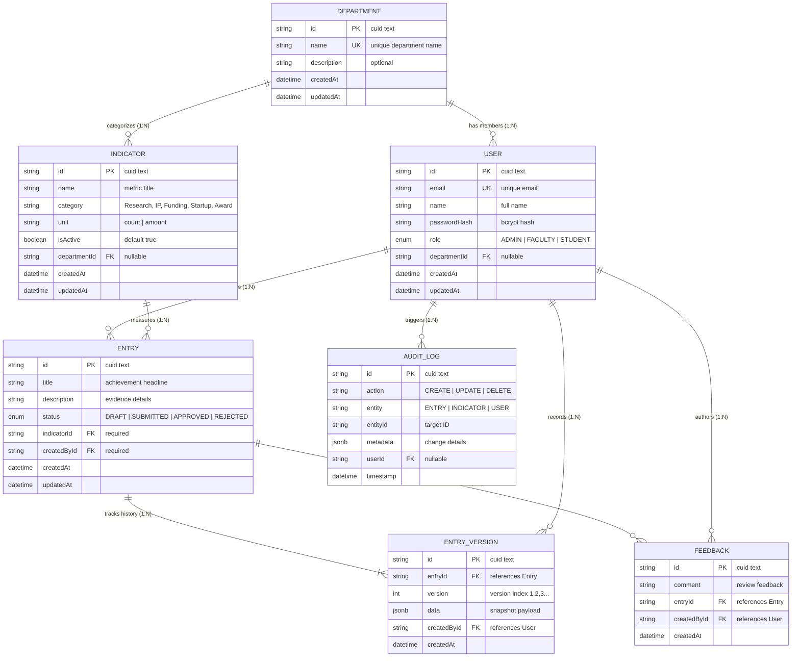
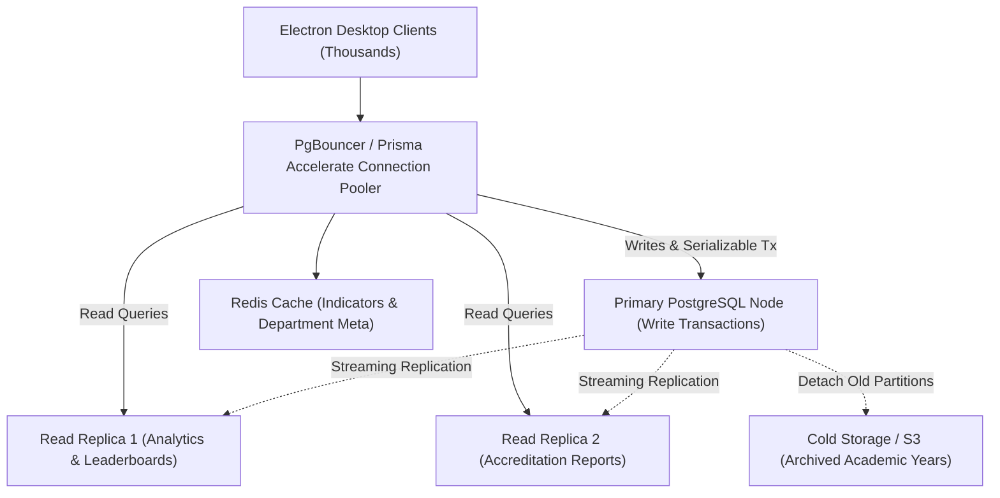

# Database Engineering (DE) — Viva Questions & Answers

**Project Title:** Portal for Innovation Excellence Indicators  
**Target Systems:** Institutional Accreditation (NIRF, NAAC, NBA)  
**Database Technology:** PostgreSQL (via Prisma ORM & Raw SQL Migrations)  

---

## Table of Contents
1. [Q1: Choice of Database](#q1-why-did-you-choose-this-database)
2. [Q2: Schema Architecture & Data Model](#q2-walk-us-through-your-schema-or-data-model)
3. [Q3: Normalization & Deliberate Denormalization](#q3-what-normal-form-is-your-design-in-and-where-did-you-deliberately-break-it)
4. [Q4: Data Correctness, Constraints & Transactions](#q4-how-does-your-database-protect-data-correctness)
5. [Q5: Efficiency, Indexing & 100× Scaling](#q5-how-did-you-make-your-database-usage-efficient)

---

## Q1. Why did you choose this database?

> **Question & Guidelines:**  
> Name the database you used and its type (relational, document, key-value, graph, etc.). Explain why it was suitable for your project’s data and usage.  
> **Cover:**
> - What your data looks like: structured, semi-structured, or highly connected.
> - Your main read and write patterns and the approximate amount of data you expect.
> - Whether you needed strong consistency or transactions.
> - At least one alternative database you considered and why you rejected it.  
> **Show:** A sample of your actual project data and the 2–3 most frequent queries or operations in your application.

---

### 1. Database & Classification
- **Database:** **PostgreSQL** (version 15+) interfaced through **Prisma ORM** in Node.js.
- **Type:** **Relational Database Management System (RDBMS)** with native **JSONB** hybrid semi-structured storage support.

### 2. Why It Was Suitable for the Project

#### Data Characteristics
The data domain is **strictly structured and highly relational**:
- Educational accreditation frameworks (NIRF, NAAC, NBA) require accountability and clear entity ownership:
  - Every `User` belongs to a `Department`.
  - Every `Indicator` (e.g., "Patents Filed", "Research Grants") belongs to a `Department` or is institutional.
  - Every `Entry` is submitted by a `User` under an `Indicator`.
  - Every `Entry` tracks a 1-to-many history of `EntryVersion` records, `Feedback` review comments, and an immutable `AuditLog` trail.

#### Read & Write Patterns & Volume
- **Read-Heavy Workload (85% reads, 15% writes):**
  - Continuous reads for institutional leaderboards, department summary scorecards, filterable approval queues, and NAAC export reports.
  - Writes occur in bursts during semester/annual accreditation submission deadlines, including bulk uploads of CSV records containing dozens of papers and patents.
- **Expected Data Volume:** 
  - Medium-to-large institutional scope: 5,000–50,000 active users (faculty and students), 50–200 departments/centers, and hundreds of thousands of activity entries over multiple academic reporting years.

#### Strong Consistency & Multi-Table Transactions
- **Strong Consistency is Non-Negotiable:**
  - In accreditation reporting, phantom data or orphan records invalidate audit results. 
  - Updating an entry and generating a new version snapshot must succeed or fail together as an indivisible unit (**ACID Atomicity**).
  - Version increments (`v1` $\rightarrow$ `v2`) must be strictly sequential and isolated against concurrent editing.

#### Alternative Considered and Rejected: MongoDB (Document Database)
- **Why Considered:** MongoDB offers flexible schemas and simple JSON-like document embedding.
- **Why Rejected:**
  1. **Referential Integrity Risks:** MongoDB does not enforce relational delete safety natively. In PostgreSQL, `ON DELETE RESTRICT` guarantees that an `Indicator` or `User` cannot be deleted if active achievement submissions reference it. In MongoDB, this requires fragile application-level validation.
  2. **Complex Aggregations & Joins:** Accreditation queries require joining `Entry` $\rightarrow$ `Indicator` $\rightarrow$ `Department` $\rightarrow$ `User`. In MongoDB, multi-stage `$lookup` pipelines are computationally expensive, lack foreign key index guarantees, and complicate simple reporting queries.

---

### 3. Actual Project Data Sample

#### Live Entry with Embedded Version Snapshot (`Entry` + `EntryVersion`)
```json
{
  "id": "cly101entryabc",
  "title": "Deep Learning for Real-Time Medical Image Diagnostics",
  "description": "Published in IEEE Access, DOI: 10.1109/ACCESS.2026",
  "status": "APPROVED",
  "indicatorId": "cly102indpaper",
  "createdById": "cly103profsharma",
  "createdAt": "2026-10-15T09:30:00.000Z",
  "updatedAt": "2026-10-16T14:20:00.000Z",
  "version": {
    "version": 1,
    "data": {
      "title": "Deep Learning for Real-Time Medical Image Diagnostics",
      "description": "Published in IEEE Access, DOI: 10.1109/ACCESS.2026",
      "status": "APPROVED",
      "indicatorId": "cly102indpaper"
    }
  }
}
```

---

### 4. The 3 Most Frequent Operations

#### 1. User Authentication & Role Verification
```javascript
// src/controllers/authController.js
const user = await prisma.user.findUnique({
  where: { email: req.body.email.toLowerCase() }
});
```

#### 2. Filtered Submissions Query with Relational Joins
```javascript
// src/controllers/entryController.js
const entries = await prisma.entry.findMany({
  where: { status: 'SUBMITTED' },
  include: {
    indicator: { select: { id: true, name: true, category: true, unit: true } },
    createdBy: { select: { id: true, name: true, email: true, role: true } }
  },
  orderBy: { createdAt: 'desc' }
});
```

#### 3. Atomic Multi-Table Versioned Submission Transaction
```javascript
// src/controllers/entryController.js
const result = await prisma.$transaction(async (tx) => {
  const entry = await tx.entry.create({
    data: { title, description, indicatorId, createdById: req.user.id, status: 'DRAFT' }
  });
  const version = await tx.entryVersion.create({
    data: {
      entryId: entry.id,
      version: 1,
      data: { title: entry.title, description: entry.description, status: entry.status },
      createdById: req.user.id
    }
  });
  return { entry, version };
});
```

---

## Q2. Walk us through your schema or data model.

> **Question & Guidelines:**  
> If you use a relational database:  
> - Present your ER diagram or tables.  
> - Explain entities, primary keys, foreign keys and relationships (1:1, 1:N, M:N).  
> - Explain how you resolved M:N relationships.  
> **Show:** Your schema in the database tool or migration files, along with one query that joins or reads across the main relationship.

---

### 1. Entity-Relationship Diagram (ERD)



---

### 2. Entities, Primary Keys, Foreign Keys & Multiplicities

| Entity Table | Primary Key | Foreign Keys & Target | Multiplicity | Referential Action (`ON DELETE`) |
|---|---|---|---|---|
| **`User`** | `id` (CUID) | `departmentId` $\rightarrow$ `Department(id)` | 1:N | `ON DELETE SET NULL` (user remains if department is re-organized) |
| **`Department`** | `id` (CUID) | None | 1:N with User/Indicator | Root master entity |
| **`Indicator`** | `id` (CUID) | `departmentId` $\rightarrow$ `Department(id)` | 1:N | `ON DELETE SET NULL` |
| **`Entry`** | `id` (CUID) | `indicatorId` $\rightarrow$ `Indicator(id)`<br>`createdById` $\rightarrow$ `User(id)` | 1:N<br>1:N | `ON DELETE RESTRICT` (cannot delete indicator/user if achievements exist) |
| **`EntryVersion`** | `id` (CUID) | `entryId` $\rightarrow$ `Entry(id)`<br>`createdById` $\rightarrow$ `User(id)` | 1:N<br>1:N | `ON DELETE CASCADE` (versions are purged if entry is purged) |
| **`Feedback`** | `id` (CUID) | `entryId` $\rightarrow$ `Entry(id)`<br>`createdById` $\rightarrow$ `User(id)` | 1:N<br>1:N | `ON DELETE CASCADE` |
| **`AuditLog`** | `id` (CUID) | `userId` $\rightarrow$ `User(id)` | 1:N | `ON DELETE SET NULL` (audit trail preserved even if user is removed) |

---

### 3. Resolution of Many-to-Many (M:N) Relationships
- **The Problem:** Conceptually, an educational institute has a Many-to-Many relationship between **Users** (Faculty/Students) and **Indicators** (Research Papers, Patents, Grants):
  - One user submits multiple indicators over time.
  - One indicator receives submissions from multiple users.
- **The Resolution:** We do not use a naive join table with just IDs. Instead, the M:N relationship is resolved through the **associative entity `Entry`**, which promotes the join into a first-class domain model capturing transactional attributes:
  - `title`, `description`, `status` (DRAFT, SUBMITTED, APPROVED, REJECTED), `createdAt`, and `updatedAt`.
  - This turns the M:N relationship into two clean 1:N relationships:
    $$\text{User (1)} \longleftrightarrow \text{(N) Entry (N)} \longleftrightarrow \text{(1) Indicator}$$

---

### 4. Raw SQL Migration DDL (`prisma/migrations/20261112090625_init/migration.sql`)
```sql
-- CreateEnum
CREATE TYPE "Role" AS ENUM ('ADMIN', 'FACULTY', 'STUDENT');
CREATE TYPE "EntryStatus" AS ENUM ('DRAFT', 'SUBMITTED', 'APPROVED', 'REJECTED');

-- CreateTable Entry
CREATE TABLE "Entry" (
    "id" TEXT NOT NULL,
    "title" TEXT NOT NULL,
    "description" TEXT,
    "status" "EntryStatus" NOT NULL DEFAULT 'DRAFT',
    "indicatorId" TEXT NOT NULL,
    "createdById" TEXT NOT NULL,
    "createdAt" TIMESTAMP(3) NOT NULL DEFAULT CURRENT_TIMESTAMP,
    "updatedAt" TIMESTAMP(3) NOT NULL,
    CONSTRAINT "Entry_pkey" PRIMARY KEY ("id")
);

-- Foreign Key Constraints with RESTRICT & CASCADE
ALTER TABLE "Entry" ADD CONSTRAINT "Entry_indicatorId_fkey" 
    FOREIGN KEY ("indicatorId") REFERENCES "Indicator"("id") ON DELETE RESTRICT ON UPDATE CASCADE;

ALTER TABLE "Entry" ADD CONSTRAINT "Entry_createdById_fkey" 
    FOREIGN KEY ("createdById") REFERENCES "User"("id") ON DELETE RESTRICT ON UPDATE CASCADE;

ALTER TABLE "EntryVersion" ADD CONSTRAINT "EntryVersion_entryId_fkey" 
    FOREIGN KEY ("entryId") REFERENCES "Entry"("id") ON DELETE CASCADE ON UPDATE CASCADE;
```

---

### 5. Multi-Table Join Query Across the Entire Relationship
This query from `src/controllers/entryController.js` fetches an Entry, joins the Indicator, joins the submitting User, includes the latest Version, and fetches discussion Comments:

```javascript
const entryDetails = await prisma.entry.findUnique({
  where: { id: req.params.id },
  include: {
    indicator: {
      select: { id: true, name: true, category: true, unit: true }
    },
    createdBy: {
      select: { id: true, name: true, email: true, role: true }
    },
    versions: {
      select: { id: true, version: true, createdAt: true },
      orderBy: { version: "desc" },
      take: 1
    },
    feedbacks: {
      include: {
        createdBy: { select: { id: true, name: true, role: true } }
      },
      orderBy: { createdAt: "desc" }
    }
  }
});
```

---

## Q3. What normal form is your design in, and where did you deliberately break it?

> **Question & Guidelines:**  
> For relational databases:  
> - State the highest normal form your main tables reach (2NF, 3NF or BCNF).  
> - Explain the functional dependencies of one table.  
> - Explain how you removed partial or transitive dependencies.  
> - If you denormalized anything, explain why and how you maintain its correctness.  
> **Show:** A before-and-after example of your design or a duplicated field and the code that updates it.

---

### 1. Highest Normal Form Reached
The core relational tables (`User`, `Department`, `Indicator`, `Entry`, `Feedback`) reach **Third Normal Form (3NF)** and satisfy **Boyce-Codd Normal Form (BCNF)**:

1. **1NF (Atomic Attributes):**
   - Every column contains scalar values (strings, timestamps, enums, numbers). No repeating groups or comma-separated lists exist.
2. **2NF (No Partial Dependencies):**
   - Tables use single-column surrogate primary keys (`id`). In tables with composite candidate keys like `EntryVersion(entryId, version)`, non-prime attributes (`data`, `createdById`, `createdAt`) depend strictly on the composite whole.
3. **3NF & BCNF (No Transitive Dependencies):**
   - Every non-key attribute depends directly on the primary key, and only on the primary key. Department names are isolated in `Department` rather than repeated across `User` or `Indicator`. Every determinant is a candidate key.

---

### 2. Functional Dependencies of the `Entry` Table

$$\text{Entry: } \{ id \} \longrightarrow \{ \text{title}, \text{description}, \text{status}, \text{indicatorId}, \text{createdById}, \text{createdAt}, \text{updatedAt} \}$$

- **Determinant:** The attribute $\{ id \}$ uniquely identifies all other columns in the relation.
- **Candidate Key:** $\{ id \}$ is the primary key.
- **Analysis:** Since the left-hand side of the functional dependency is a superkey, `Entry` strictly satisfies **BCNF**.

---

### 3. How We Removed Transitive Dependencies (Normalization Process)

#### Before Normalization (Unnormalized 1NF Design):
If user, department, and indicator data were stored in a single flat submissions table:
```text
FLAT_SUBMISSION (
  id, title, status, 
  userId, userName, userEmail, userRole, 
  departmentId, departmentName, departmentHead, 
  indicatorId, indicatorName, indicatorCategory
)
```
- **Transitive Dependency 1:** $\text{id} \rightarrow \text{userId} \rightarrow \text{userName}, \text{userEmail}, \text{departmentId}$
- **Transitive Dependency 2:** $\text{userId} \rightarrow \text{departmentId} \rightarrow \text{departmentName}$
- **Transitive Dependency 3:** $\text{id} \rightarrow \text{indicatorId} \rightarrow \text{indicatorName}, \text{indicatorCategory}$
- **Resulting Anomalies:**
  - *Insertion Anomaly:* Cannot define a new Department or Indicator without a submission.
  - *Deletion Anomaly:* Deleting the last submission in a department deletes all records of that department.
  - *Update Anomaly:* Renaming an indicator requires updating hundreds of rows; a partial failure creates inconsistency.

#### After Normalization (Our 3NF / BCNF Implementation):
Decomposed into distinct relations linked by foreign keys:
- `Department` $(\underline{id}, name, description)$
- `User` $(\underline{id}, name, email, passwordHash, role, departmentId^*)$
- `Indicator` $(\underline{id}, name, category, unit, isActive, departmentId^*)$
- `Entry` $(\underline{id}, title, description, status, indicatorId^*, createdById^*)$

---

### 4. Where We Deliberately Broke Normalization (Controlled Denormalization)

We strategically introduced denormalization in two specific places using PostgreSQL's native **`JSONB` engine**:

#### 1. `EntryVersion.data` (Immutable Point-in-Time Snapshot)
- **What is Denormalized:** Instead of creating a complex normalized version tree with recursive keys or separate `VersionField` rows, we store the full snapshot of the entry (`{ title, description, status, indicatorId }`) as a denormalized JSONB document.
- **Why We Denormalized:**
  - **Audit Immutability:** In academic rankings, an approved version from 2024 must remain frozen exactly as evaluated. If the parent `Indicator` name or category changes in 2026, the 2024 version must not reflect the new name.
  - **Query Performance:** Fetching the historical snapshot requires a single index lookup on `(entryId, version)` with zero joins.
- **How Correctness is Maintained:**
  - `EntryVersion` records are **insert-only**. No application endpoint issues an `UPDATE` on `EntryVersion`.
  - Composite unique constraint `@@unique([entryId, version])` physically prevents version collisions.

#### 2. Before-and-After Code Example (Snapshot Generation)
```javascript
// src/controllers/entryController.js (updateEntry)
// Denormalized snapshot captured at the exact moment of update:
const newVersion = await tx.entryVersion.create({
  data: {
    entryId: id,
    version: newVersionNumber,
    // Deliberately denormalized snapshot payload:
    data: {
      title: updatedEntry.title,
      description: updatedEntry.description,
      status: updatedEntry.status,
      indicatorId: updatedEntry.indicatorId
    },
    createdById: req.user.id
  }
});
```

---

## Q4. How does your database protect data correctness?

> **Question & Guidelines:**  
> **Cover:**
> - Constraints: Which constraints have you used (`NOT NULL`, `UNIQUE`, `CHECK`, foreign keys)? Which rules are enforced by the database and which are handled in application code?
> - Transactions: Explain one operation that changes multiple records together. How do you ensure atomicity, and what happens if it fails halfway?
> - Concurrency: What happens if two users perform the same operation simultaneously? Explain the isolation level or locking approach used.  
> **Show:** Your constraint definitions and transaction code. Demonstrating a constraint rejecting invalid data will earn extra credit.

---

### 1. Database-Enforced vs. Application-Enforced Constraints

| Category | Constraint | Enforced By | Specific Schema / Code Implementation |
|---|---|---|---|
| **Identity** | Primary Key | Database | `id TEXT PRIMARY KEY` (CUID) on all 7 tables |
| **Uniqueness** | Unique Key | Database | `CREATE UNIQUE INDEX "User_email_key" ON "User"("email")`<br>`CREATE UNIQUE INDEX "Department_name_key" ON "Department"("name")`<br>`CREATE UNIQUE INDEX "EntryVersion_entryId_version_key" ON "EntryVersion"("entryId", "version")` |
| **Completeness** | `NOT NULL` | Database | `title TEXT NOT NULL`, `indicatorId TEXT NOT NULL`, `createdById TEXT NOT NULL`, `passwordHash TEXT NOT NULL` |
| **Referential Integrity** | Foreign Key (`RESTRICT`) | Database | `FOREIGN KEY ("indicatorId") REFERENCES "Indicator"("id") ON DELETE RESTRICT`<br>*(Database rejects deleting an indicator if entries reference it)* |
| **Referential Integrity** | Foreign Key (`CASCADE`) | Database | `FOREIGN KEY ("entryId") REFERENCES "Entry"("id") ON DELETE CASCADE`<br>*(Purging an entry automatically cascades and cleans up child versions and feedback)* |
| **Type Integrity** | Native ENUM | Database | PostgreSQL `CREATE TYPE "Role" AS ENUM ('ADMIN', 'FACULTY', 'STUDENT')`<br>`CREATE TYPE "EntryStatus" AS ENUM ('DRAFT', 'SUBMITTED', 'APPROVED', 'REJECTED')` |
| **Business Logic** | State Transitions | Application | Only users with role `ADMIN` can update an entry's status to `APPROVED` or `REJECTED` |
| **Input Hygiene** | String Sanitization | Application | Verifies `title.trim().length > 0` and rejects empty strings before querying |

---

### 2. Multi-Record Transactions & Atomicity

In `createEntry`, creating the parent `Entry` and creating its initial `EntryVersion (version: 1)` is wrapped in an atomic **`prisma.$transaction`**:

```javascript
// src/controllers/entryController.js
const result = await prisma.$transaction(async (tx) => {
  // Step 1: Create the entry in DRAFT status
  const entry = await tx.entry.create({
    data: {
      title: title.trim(),
      description: description?.trim() || null,
      indicatorId,
      createdById: req.user.id,
      status: "DRAFT"
    }
  });

  // Step 2: Create Version 1 snapshot
  const version = await tx.entryVersion.create({
    data: {
      entryId: entry.id,
      version: 1,
      data: {
        title: entry.title,
        description: entry.description,
        status: entry.status,
        indicatorId: entry.indicatorId
      },
      createdById: req.user.id
    }
  });

  return { entry, version };
});
```

#### What happens if it fails halfway?
- If Step 2 fails (e.g., version table lock, unique constraint violation, or disk full), PostgreSQL issues a complete **ROLLBACK**.
- The `Entry` record created in Step 1 is erased.
- The database is guaranteed never to contain an orphan entry lacking a matching version 1 record.

---

### 3. Concurrency Control: Serializable Isolation & Optimistic Retries

When two users edit the same pending entry simultaneously:
1. **The Race Condition:** Both user A and user B read the current record as `version: 1`. Both calculate `newVersion = 2`. In standard `Read Committed` isolation, both might attempt to write version 2, causing an application error or overwrite.
2. **Our Solution:** We enforce **`Serializable` isolation** (the highest SQL isolation level) paired with an **automatic retry loop**:

```javascript
// src/controllers/entryController.js (updateEntry)
const maxRetries = 3;

for (let attempt = 1; attempt <= maxRetries; attempt++) {
  try {
    result = await prisma.$transaction(
      async (tx) => {
        // Update entry fields
        const updatedEntry = await tx.entry.update({
          where: { id },
          data: { ...(title && { title }), ...(status && { status }) }
        });

        // Re-read latest version within the serializable boundary
        const latestVersion = await tx.entryVersion.findFirst({
          where: { entryId: id },
          orderBy: { version: "desc" }
        });

        const newVersionNumber = (latestVersion?.version || 0) + 1;

        // Insert new version
        const newVersion = await tx.entryVersion.create({
          data: {
            entryId: id,
            version: newVersionNumber,
            data: { title: updatedEntry.title, status: updatedEntry.status },
            createdById: req.user.id
          }
        });

        return { entry: updatedEntry, version: newVersion };
      },
      {
        isolationLevel: "Serializable" // Guarantees strict linear serialization
      }
    );

    break; // Transaction committed successfully
  } catch (error) {
    // P2034 is PostgreSQL serialization failure (could not serialize access due to concurrent update)
    if (error.code === "P2034" && attempt < maxRetries) {
      console.log(`Concurrent conflict on attempt ${attempt}. Retrying with latest state...`);
      continue; // Re-fetches the latest version and increments cleanly
    }
    throw error;
  }
}
```

---

## Q5. How did you make your database usage efficient?

> **Question & Guidelines:**  
> **Cover:**
> - Which indexes did you create, on which columns or fields, and which queries do they support?
> - Did you consider any indexes but decide against them because of their write overhead?
> - Mention other techniques used, such as sharding, partitioning, etc.
> - If your user base grew 100 times, what would break first, and what would you change?

---

### 1. Strategic B-Tree Indexes Created

Our production migration ([`migration.sql`](file:///Users/adityarajsingh/Desktop/major%20project/prisma/migrations/20261112090625_init/migration.sql)) defines indexes on every foreign key and high-frequency filter column:

```sql
-- 1. Accelerates Admin Approval Queue lookups (WHERE status = 'SUBMITTED')
CREATE INDEX "Entry_status_idx" ON "Entry"("status");

-- 2. Powers NIRF / NAAC aggregation reports (GROUP BY indicatorId)
CREATE INDEX "Entry_indicatorId_idx" ON "Entry"("indicatorId");

-- 3. Optimizes "My Entries" dashboard for Faculty and Students
CREATE INDEX "Entry_createdById_idx" ON "Entry"("createdById");

-- 4. Guarantees O(1) version lookups and prevents duplicate version indices
CREATE UNIQUE INDEX "EntryVersion_entryId_version_key" ON "EntryVersion"("entryId", "version");

-- 5. Speeds up comment loading when viewing entry detail drawers
CREATE INDEX "Feedback_entryId_idx" ON "Feedback"("entryId");

-- 6. Optimizes compliance timeline queries
CREATE INDEX "AuditLog_entity_entityId_idx" ON "AuditLog"("entity", "entityId");
CREATE INDEX "AuditLog_timestamp_idx" ON "AuditLog"("timestamp");

-- 7. Speeds up user role authorization checks
CREATE INDEX "User_role_idx" ON "User"("role");
```

---

### 2. Indexes Considered but Intentionally Omitted

1. **Full-Text GIN Index on `Entry.description`:**
   - *Why Considered:* For keyword searching through research abstract text.
   - *Why Omitted:* Generalized Inverted Indexes (GIN) have substantial memory and write overhead. Because faculty frequently perform bulk CSV imports of dozens of records, updating a GIN index on every inserted row significantly degrades write throughput. Standard indexed filtering by `indicatorId` and `status` satisfied current requirements.
2. **Expression Indexes on `EntryVersion.data` JSONB sub-keys:**
   - *Why Omitted:* Version records are retrieved by `(entryId, version)` and displayed as full objects, rather than filtered by internal JSON properties. Indexing JSON sub-keys would waste disk space and write cycles without query benefits.

---

### 3. Scaling to 100× Growth: What Breaks First & Architectural Roadmap

If the institution expands to a statewide university system with **100× data volume** (5,000,000+ entries, 500,000+ users, tens of millions of version and audit records):

#### What Breaks First:
1. **Database Connection Pool Exhaustion:**
   - Hundreds of Electron desktop clients opening direct connections simultaneously will exceed PostgreSQL's max client connection threshold (`max_connections`), throwing connection refused errors.
2. **AuditLog & EntryVersion Table Bloat:**
   - Because `AuditLog` and `EntryVersion` are append-only tables, they will grow into the tens of millions of rows, degrading buffer cache hit ratios and slowing down backup routines.
3. **Analytical Aggregations:**
   - Department-wide NIRF calculations scanning millions of rows in real time will cause high CPU utilization on the primary database node.

---

### 4. Architectural Mitigations for 100× Scale



1. **Connection Pooling (PgBouncer / Prisma Accelerate):**
   - Introduce **PgBouncer** in transaction pooling mode. This multiplexes thousands of desktop client requests over a fixed pool of ~100 server connections, eliminating connection starvation.
2. **PostgreSQL Declarative Table Partitioning:**
   - Partition `Entry`, `EntryVersion`, and `AuditLog` by academic cycle using range partitioning on `createdAt` / `timestamp`:
     ```sql
     CREATE TABLE "AuditLog_2025" PARTITION OF "AuditLog"
         FOR VALUES FROM ('2025-01-01') TO ('2026-01-01');
     CREATE TABLE "AuditLog_2026" PARTITION OF "AuditLog"
         FOR VALUES FROM ('2026-01-01') TO ('2027-01-01');
     ```
   - Queries for the active academic year only scan the relevant partition (**partition pruning**). Inactive partitions from past years can be archived to cold storage.
3. **Read Replicas & CQRS:**
   - Separate Command and Query responsibilities:
     - **Primary Node:** Handles writes (`createEntry`, `updateEntryStatus`, `executeCsvImport`).
     - **Read-Only Replicas:** Read-heavy analytics (`GET /api/reports`, `GET /api/leaderboard`) query replicas via streaming replication, preventing report queries from locking operational tables.
4. **Redis In-Memory Caching:**
   - Cache static and low-velocity read sets (such as active `Indicator` definitions and `Department` lists) in **Redis**. Invalidate cache keys using write-through invalidation when an admin updates an indicator.
